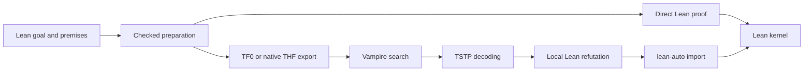

# Proof pipeline

VampireHammer prepares a refutation goal from the selected premises. It first
tries a direct Lean proof; otherwise it translates the problem, runs Vampire
and reconstructs the returned proof.

lean-auto provides monomorphization, reification and checked preprocessing.
TF0 is the typed first-order format; THF preserves supported higher-order
terms. By default the routes race after shared monomorphization, alongside a
goal-decomposition attempt when applicable. Only the first successful replay
is committed; other attempts are cancelled. By default the FO portfolio uses
all processors remaining after reserving one for HO. Concurrent direct and
split searches divide the processor budget; `portfolioCores` can cap each
portfolio. Set `parallel := false` to use
the sequential schedule with a shared search budget.

Replay checks source facts and reconstructs derived nodes from their parents.
The completed local theorem crosses the lean-auto import boundary once.
A successful external search closes the goal only when reconstruction and
Lean kernel checking succeed.

See the [module map](../VampireHammer/README.md),
[reconstruction guide](RECONSTRUCTION_DESIGN.md) and
[option reference](TACTIC_OPTIONS.md).
